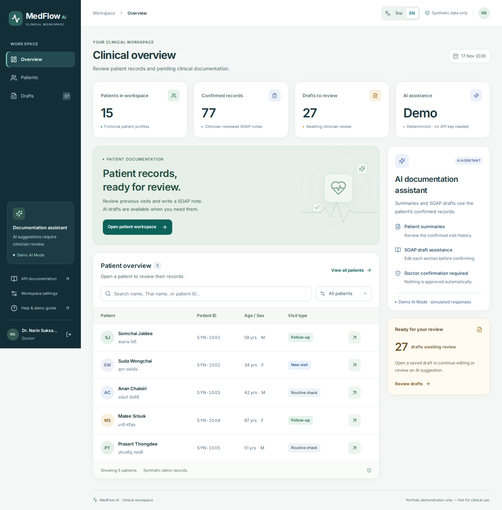
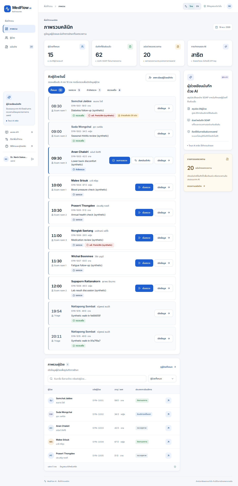
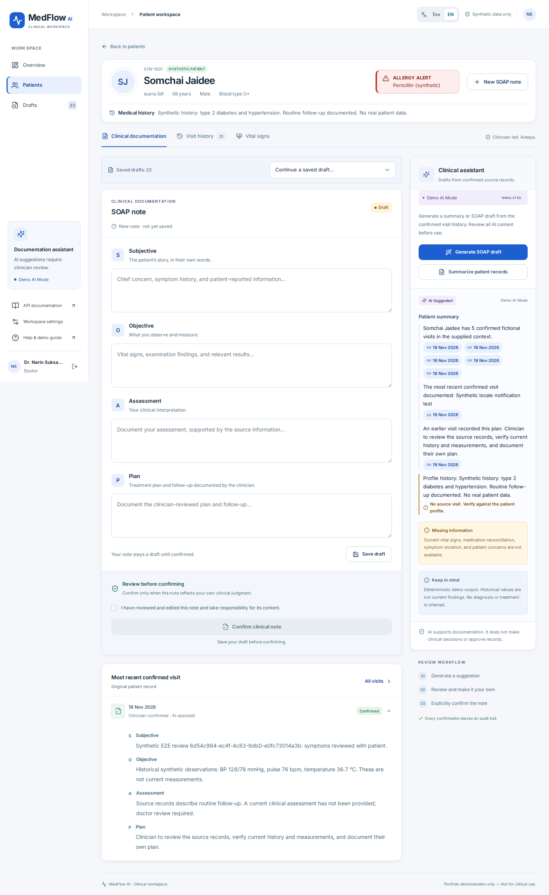
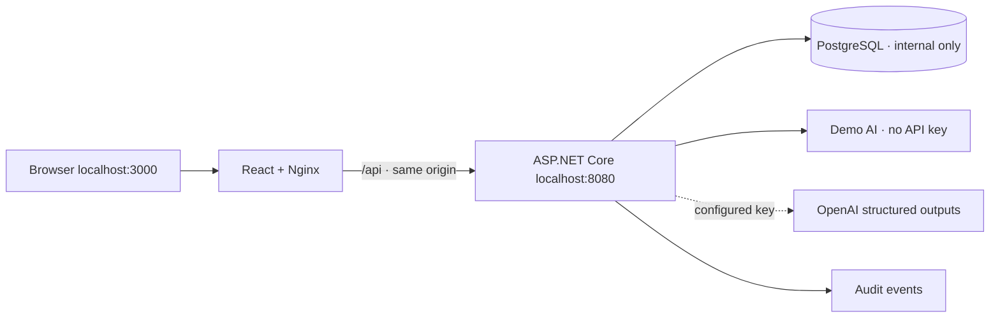
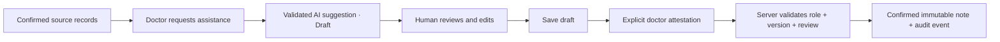

# MedFlow AI

**A clinical workspace that gives documentation a thoughtful second look.**

MedFlow AI is a full-stack portfolio MVP with a bilingual patient directory, electronic medical records, structured AI documentation assistance, explicit doctor review, and an audit trail. It is designed so a recruiter can explore a realistic workflow immediately after one Docker Compose command.

> **Portfolio demonstration only — Not for clinical use.** All patients, histories, observations and credentials are synthetic. This project makes no healthcare certification or regulatory compliance claims.



The interface supports Thai and English. Use **ไทย / EN** on the login screen or in the workspace header; the browser remembers your preference. Source clinical text remains in its recorded language. [Theme and localization details](docs/theme-and-localization.md).



## Quick start

Install and start Docker Engine / Docker Desktop with Docker Compose v2 and Linux containers. No Node.js, npm, .NET SDK, EF CLI or PostgreSQL installation is required.

```bash
git clone https://github.com/TaoSuphakorn/MedFlow.git
cd MedFlow
docker compose up --build -d
```

No `.env` copy, manual migration, seed command or API key is required. The first build downloads dependencies and images; allow several minutes depending on your connection. Use `docker compose ps` to check readiness.

| Service    | URL                                                            |
| ---------- | -------------------------------------------------------------- |
| Frontend   | [http://localhost:3000](http://localhost:3000)                 |
| API health | [http://localhost:8080/health](http://localhost:8080/health)   |
| Swagger    | [http://localhost:8080/swagger](http://localhost:8080/swagger) |
| PostgreSQL | Internal Docker network only; no published port                |

Ports bind to `127.0.0.1` for local use. Stop with `docker compose down`; data persists in named volumes. **`docker compose down -v` permanently removes the demo database and saved records.**

## Demo accounts

| Role          | Email                 | Password    | Permissions                                                |
| ------------- | --------------------- | ----------- | ---------------------------------------------------------- |
| Doctor        | `doctor@medflow.demo` | `Demo!2026` | Read records, create/edit drafts, request AI, confirm SOAP |
| Nurse         | `nurse@medflow.demo`  | `Demo!2026` | Read records, create/edit drafts, request AI               |
| Administrator | `admin@medflow.demo`  | `Demo!2026` | Read records and audit events                              |

Select a role on the login screen to prefill its email. Passwords are hashed with ASP.NET Identity's PBKDF2 password hasher. These publicly documented accounts exist only for the local demo.

## Explore the workflow

1. Sign in as Doctor and open **Patients**.
2. Search `SYN-1001`, `Somchai`, or `สมชาย` and open the patient.
3. Inspect **Visit history** to see original confirmed notes.
4. Select **Generate SOAP draft**. The content is visibly labeled **AI Suggested** and **Demo AI Mode**, including missing information and uncertainty.
5. Review and edit every SOAP section, then **Save draft**.
6. Check the review attestation and select **Confirm clinical note**.
7. Reopen the patient to verify the saved, immutable record. Sign in as Administrator to inspect the audit trail.



See the [five-minute demo guide](docs/demo-guide.md) for a presentation walkthrough.

## Features

- Fifteen fictional Thai patients with Thai/English names, synthetic identifiers, demographic details, history and allergy information.
- At least three seeded confirmed visits per patient, plus an example unapproved AI draft and audit event.
- Patient search and visit-type filtering, visit history, draft selection, SOAP creation/editing and clear loading/empty/error states.
- Doctor-only explicit confirmation, immutable approved records and optimistic concurrency to reject stale edits.
- AI summaries and SOAP suggestions with source separation, missing information and uncertainty disclosures.
- Real cookie authentication, CSRF protection, server-side authorization and metadata-only auditing.
- Responsive desktop/tablet UI with self-hosted Latin and Thai fonts and accessible Radix dialog primitives.
- Docker-only startup, dependency installation, migrations, seed and tests.
- Today's clinic worklist for exam-room tablets: check-in, Waiting → In exam → Completed with versioned, audited status changes.
- Sticky patient banner with a red allergy alert, and per-section AI provenance: every AI-suggested SOAP section must be edited or marked reviewed by a doctor, enforced by the API.
- AI summaries cite their source visits sentence by sentence; unsupported sentences are flagged and citations are validated server-side.
- Vital signs with warning/critical alerts (demonstration thresholds), trend charts with a table view, and audited entry.
- Clean Clinical Blue theme. See the [redesign and roadmap](docs/roadmap.md) for details and next steps.

## Technology

| Layer           | Stack                                                                                                 |
| --------------- | ----------------------------------------------------------------------------------------------------- |
| Frontend        | React 19, TypeScript, Vite 7, Tailwind CSS 4, shadcn/ui-style source components with Radix primitives |
| State and forms | TanStack Query 5, React Hook Form 7, Zod 4                                                            |
| Backend         | ASP.NET Core 10, EF Core 10, Npgsql, PostgreSQL 17                                                    |
| AI              | Server-side OpenAI REST integration with strict JSON schema; deterministic demo provider              |
| Infrastructure  | Multi-stage Dockerfiles, Docker Compose, Nginx reverse proxy, health checks and persistent volumes    |
| Tests           | xUnit API integration tests against PostgreSQL; Playwright Chromium E2E                               |

Frontend dependencies are pinned by `package-lock.json`; Docker uses `npm ci`. Application dependencies are restored and built inside containers.

## Architecture



Startup order is enforced by Compose dependencies and backend initialization:

```text
PostgreSQL healthy → EF Core migrations → idempotent seed → API healthy → frontend
```

The backend is the single migration/seed owner and does not listen until initialization succeeds. It never combines `EnsureCreated()` with migrations. Seed keys prevent duplicates; repeated starts never reset records. PostgreSQL and cookie-protection keys use persistent volumes.

Read [architecture.md](docs/architecture.md) for data boundaries, authorization and operational tradeoffs.

## AI and human review



With no key, **Demo AI Mode** is deterministic and clearly marked as simulated. With a key, the API uses OpenAI's structured response schema, validates every required field and handles refusals, errors and timeouts. Historical information is not represented as a current examination. Only confirmed records are sent as source context. AI cannot confirm records or independently make clinical decisions.

Summary suggestions remain unapproved assistance and cannot be confirmed as clinical notes. They are excluded from the pending SOAP draft count. Only SOAP drafts support doctor confirmation. A live upstream failure does not silently become a mock response.

## Environment configuration

All defaults are supplied in Compose. `.env.example` documents optional overrides:

| Variable            | Default              | Notes                                                            |
| ------------------- | -------------------- | ---------------------------------------------------------------- |
| `OPENAI_API_KEY`    | Empty                | Enables live AI when set; server only                            |
| `OPENAI_MODEL`      | `gpt-4o-mini`        | Must support structured outputs and be available to your account |
| `POSTGRES_PASSWORD` | `local-demo-db-only` | Local demo default, not a deployment secret                      |
| `DEMO_PASSWORD`     | `Demo!2026`          | Applied only when seed users are first inserted                  |

Optional live configuration in an ignored `.env`:

```dotenv
OPENAI_API_KEY=your-key-here
OPENAI_MODEL=gpt-4o-mini
```

Then run `docker compose up -d`. Live generation incurs OpenAI usage charges and sends synthetic source context to OpenAI. Use the deterministic default for a free demonstration. No live paid calls were made during development verification.

Changing `DEMO_PASSWORD` does not rotate existing users' hashes. Changing the PostgreSQL password on an existing volume also requires changing the database role password; image initialization variables apply only to a new volume. Do not delete data merely to change a password.

## Testing through Docker

Start the application, then run:

```bash
docker compose --profile test run --build --rm backend-tests
docker compose --profile test run --build --rm e2e
```

Backend tests use a separate internal PostgreSQL service with temporary storage. They exercise patient retrieval/search, login, CSRF, SOAP validation, role authorization, stale writes, confirmation, AI structured-response handling, failures, and repeated seed preservation.

Playwright exercises the real Nginx/API/database path: login → patient search → AI generation → edit → save → explicit confirmation → reload and verify unique saved text. It also covers full-length Thai requests, unsaved-edit warnings, administrator draft labels, nurse permissions, tablet overflow, auditing, empty search and logout. E2E creates synthetic notes in the demo database; approved notes are intentionally retained. It expects the default demo password and explicitly checks Demo AI Mode before generation, so an accidentally configured live key causes the AI workflow test to fail before any paid request.

Artifacts are written to `frontend/test-results/` and `frontend/playwright-report/`. Screenshots used above are generated during the workflow test. Live OpenAI transport is covered with an HTTP stub; actual paid endpoint behavior requires separately authorized configuration and verification.

## Automated CI

The GitHub Actions workflow builds the application through Docker, checks fresh database initialization, runs both test suites and verifies records survive a restart. It uses an isolated database with Demo AI forced on and no published ports. Test reports, traces and Docker diagnostics are retained as workflow artifacts.

See [CI setup and local reproduction](docs/ci.md). The workflow is committed locally; a GitHub-hosted run has not been triggered because this checkout has no remote repository.

For health and startup diagnostics:

```bash
docker compose ps
docker compose logs --tail=100 backend
docker compose logs --tail=100 postgres
```

## Security considerations

- Backend role enforcement protects every write and doctor confirmation. Client-provided status/provenance cannot approve a draft.
- HttpOnly, SameSite=Strict cookies; antiforgery token required on writes; no API key or auth token in localStorage.
- EF Core parameterized access, bounded requests and text validation, React text escaping, Nginx CSP, safe API errors and login/AI rate limits.
- Audit events contain metadata only. No passwords, keys or clinical payloads are intentionally logged.
- `.env` is ignored. Runtime images use the ASP.NET non-root user; PostgreSQL is not exposed to the host network.
- Prompt defenses treat source records as untrusted data. Human review is still essential and prompt-injection protection is not a guarantee.

## Known limitations and next steps

This is a local, single-backend portfolio MVP. It is not suitable for real patient information or clinical care. It has no tenant isolation, account management, password reset, clinical validation, formal compliance controls, tamper-proof audit storage, backups or production secret management. API Swagger is enabled only in the local `Demo` environment. UI languages are Thai and English; clinical source content and audit action codes are not automatically translated.

AI suggestions can be inaccurate. Real OpenAI calls were not exercised because paid calls require explicit authorization. The healthcare behavior has not been clinically validated. Data-protection keys on the local Docker volume are not encrypted at rest. Login rate limiting is local to the single process; behind Nginx the shared proxy address contributes to its demo-wide limit.

Future work: external identity and MFA, patient-level permissions, encrypted backups, tamper-evident audit retention, a dedicated migration job for multi-instance deployment, stronger AI evaluation, accessibility auditing and additional UI languages.

See [verification.md](docs/verification.md) for actual verification results and unverified acceptance items.
