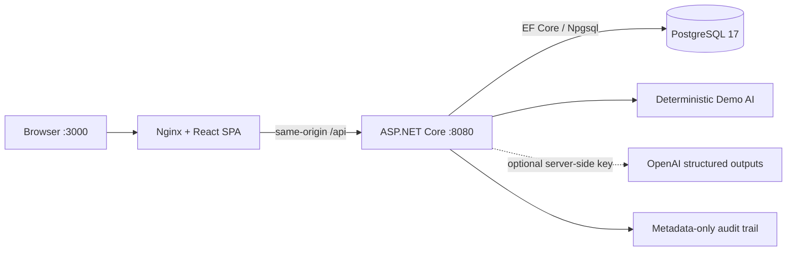

# Architecture

MedFlow AI is a local portfolio demonstration. It is not clinical software and has no healthcare certification or compliance claim. All data is synthetic.

## Startup and persistence

Compose waits for PostgreSQL's `pg_isready` health check. The single backend process calls `MigrateAsync()` using the committed migration, then runs transactional, idempotent seeding before starting its HTTP listener. Migration failure stops startup; the backend cannot become healthy with a missing schema. The frontend starts only after `/health` succeeds. Nginx's health endpoint controls frontend readiness.

There is one schema/seed owner: the backend. Do not scale the backend in this demo; a multi-instance deployment needs a dedicated one-shot migration job and seed coordination. `EnsureCreated()` is not used.

The `postgres-data` volume preserves data across restart, rebuild, and `compose down`. The `data-protection` volume preserves cookie encryption keys. Unique email, patient identifier and seed-note keys prevent duplicates. Seed only inserts missing seed records, never resets or overwrites existing user data. `DEMO_PASSWORD` applies when users are first inserted; changing it does not rotate existing passwords.

## Data model

`User` stores PBKDF2 hashes from ASP.NET Identity's password hasher. `Patient` contains fictional bilingual demographics and history. `ClinicalNote` contains SOAP text, source type, AI mode, review metadata and a concurrency version. `AuditEvent` contains an action, timestamp and internal identifiers only.

Original confirmed notes and unapproved AI suggestions are shown separately. Summary suggestions use `kind=summary`; they are never counted as pending SOAP notes and cannot be edited through the SOAP endpoint or confirmed as clinical records. AI SOAP suggestions use `kind=soap`, remain drafts, and can be edited before confirmation.

## Authentication and authorization

ASP.NET Core issues encrypted, HttpOnly, SameSite=Strict session cookies with a four-hour lifetime. The SPA keeps the CSRF request token only in memory. Each write, including login, requires a matching ASP.NET antiforgery token and cookie. No browser token is stored in localStorage. Cookies use Secure when serving production HTTPS; the loopback-only demo uses HTTP.

| Operation | Doctor | Nurse | Administrator |
|---|---|---|---|
| Browse patient records | Yes | Yes | Yes |
| Create/edit draft | Yes | Yes | No |
| Generate AI suggestion | Yes | Yes | No |
| Confirm SOAP note | Yes | No | No |
| Read audit log | No | No | Yes |

Every save uses a concurrency version. Conflicting or already-confirmed writes return 409; confirmed notes are immutable. Confirmation requires `reviewed=true`, the current version, a SOAP draft, valid sections and the Doctor role. The server never accepts a client-supplied approved status or AI provenance flag.

## AI integration

Without a key, `AiService` returns clearly labeled deterministic synthetic content. With a key, the backend calls OpenAI Chat Completions using a strict JSON schema, `store=false`, seven nonempty fields, a 35-second timeout and a 128 KB response bound. No SDK or API key is shipped to the browser.

Only the five latest confirmed SOAP records enter AI context. System instructions treat serialized source data as untrusted, prohibit following embedded instructions, require missing-information and uncertainty disclosures, and prohibit new clinical decisions. This reduces prompt-injection risk; it does not eliminate it. Human review remains mandatory.

Upstream errors, timeouts, refusals, malformed JSON and invalid fields produce safe errors and an audit failure event. Live failures do not silently fall back to mock output. There are no paid calls in automated tests: an HTTP handler substitutes only for the external API boundary.

## Boundaries and limitations

EF Core parameterizes queries; SOAP fields have explicit length limits. React renders text without HTML injection; Nginx supplies a content security policy. Database ports are not published, application ports bind only to loopback, request bodies are bounded, and login/AI routes are rate limited.

This is a single-clinic demonstration without tenant boundaries, patient-level access grants, durable tamper-proof auditing, clinical coding, patient intake, password reset, account administration or compliance controls. Deployment would require HTTPS end to end, secret management, encrypted storage and backups, least-privilege database users, identity hardening, monitoring, a security review and clinical validation.

## Reference documentation

- [ASP.NET Core cookie authentication](https://learn.microsoft.com/en-us/aspnet/core/security/authentication/cookie?view=aspnetcore-10.0)
- [Npgsql EF Core 10](https://www.npgsql.org/efcore/release-notes/10.0.html)
- [OpenAI structured outputs](https://developers.openai.com/api/docs/guides/structured-outputs)
